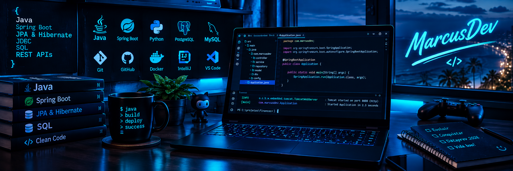

<h2 align="center">&lt;Olá, eu sou o MarcusDev /&gt;</h2>

  

 

  

 

## 

  
    Sou desenvolvedor Back-End, graduado em Análise e Desenvolvimento de Sistemas pela UNIPÊ, com experiência prática adquirida na Fábrica de Softwares.
      
    Tenho foco no desenvolvimento Back-End com Java e Spring, trabalhando com APIs REST, persistência de dados e bancos de dados relacionais, como PostgreSQL e MySQL. Também possuo experiência prática no desenvolvimento de projetos com Python e Django.
  

 

## 💻 Tecnologias

<table align="center" width="100%">
  <tr>
    <td align="center" width="33%">
      <h3>⚙️ Back-End</h3>
      
    </td>
    <td align="center" width="33%">
      <h3>🗄️ Banco de Dados</h3>
      
    </td>
    <td align="center" width="34%">
      <h3>🧩 Persistência e Build</h3>
      
    </td>
  </tr>
</table>

 

## 🛠️ Ferramentas

  

 

## 🔗 Perfis profissionais

  
  &nbsp;
  
  &nbsp;
  

 

## 🐍 Minhas contribuições

  

 

